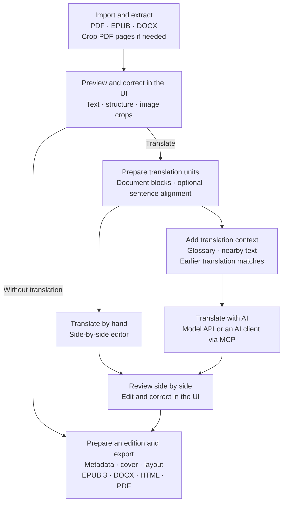

# Carlina Documents

Carlina Documents puts **quality before speed or the lowest possible cost**. It
is a workflow for carefully extracting and translating books, with the goal of
near-perfect results: preserving footnotes and endnotes, internal links,
diagrams, tables, images, captions and document structure alongside the text.

Start with a PDF, EPUB or DOCX and work towards a reviewed reading edition or
translation in **EPUB 3, PDF, DOCX or HTML**. You can preview and correct the
extraction, translate or edit by hand, and use AI for the parts you choose.
Expect to inspect difficult pages and review translation choices before
publishing. EPUB export targets EPUB 3.3; the [publishing guide](docs/epub-export.md#validation-and-qualification)
explains the checks and how to require EPUBCheck for the final edition.

[Download](#download) · [Quick start](#quick-start) · [Workflow](#workflow) ·
[Let an agent set it up](#let-an-agent-set-it-up)

## What you can do

- **Prepare and correct the source.** Select and crop PDF pages before extraction.
  Preview the result, edit text and structure, review linked notes, and adjust
  extracted image crops afterwards.
- **Translate with the original alongside.** Work by hand or with AI in a
  side-by-side editor. Translate document blocks or use local sentence splitting
  for sentence alignment, with a glossary, nearby passages and earlier
  source–translation matches supplying context.
- **Keep long jobs manageable.** Runs, batches and queued work track progress and
  accepted results. An MCP client can work through a book in smaller batches and
  continue from saved progress across many model calls.
- **Prepare an edition.** Review covers, metadata, navigation, notes, tables and
  image descriptions, then export the original-language text or its translation.

The three tools—Document Processor, Translator and Sentence Segmenter—share one
browser interface. The application and sentence splitting run locally; your
chosen AI provider may process document content remotely.

## Choosing AI and managing cost

We recommend a capable **general-purpose vision model** for scanned PDFs and
complex layouts. It needs to read the page and interpret the relationships
between text, notes, diagrams, tables and captions. Model choice and careful
review matter more here than getting through the most pages per minute.

You can configure a model API connection in Carlina, or connect an AI client
through **MCP** and let that client handle model responses. Clients such as
[Codex](https://developers.openai.com/codex/mcp),
[OpenCode](https://dev.opencode.ai/v2/docs/mcp-servers/) and
[Antigravity](https://antigravity.google/docs/mcp?tab=cli) support authenticated
HTTP MCP connections. For scanned PDFs, try a short sample to check that your
client passes the page images to its selected vision model.

Carlina manages the document, work queue, batch boundaries and result validation;
the client supplies the model work. This can reduce separate API spending when
you already have suitable model access through a client or subscription. Actual
cost depends on that service's pricing, usage limits and model access. An MCP
connection does not require another model API key in Carlina.

## Workflow



Earlier matches bring previous source–translation pairs into context. Exact and
similar-wording matches offer guidance while allowing a different translation
when the passage needs it.

## Download

**Version 0.2.0a4 is an early installer preview.** Choose a download below, or use
the source checkout instructions further down.

| System | Download |
|---|---|
| Linux x86-64 | [AppImage](https://github.com/lukaszliniewicz/carlina-documents/releases/download/v0.2.0a4/Carlina_Documents-0.2.0a4-x86_64.AppImage) |
| Linux x86-64, terminal setup | [Shell installer](https://github.com/lukaszliniewicz/carlina-documents/releases/download/v0.2.0a4/install-carlina-documents-linux-64.sh) |
| Windows 11 x86-64 | [Setup EXE](https://github.com/lukaszliniewicz/carlina-documents/releases/download/v0.2.0a4/Carlina_Documents-0.2.0a4-Setup-x86_64.exe) |

See the [installation instructions](docs/documents-application.md#packaged-downloads)
before running a download. Initial setup needs internet access. The Windows
installer is unsigned. All downloads, checksums and source files are on the
[Releases page](https://github.com/lukaszliniewicz/carlina-documents/releases).
On Windows, double-click the EXE and follow the setup window; Python is included.
The [PowerShell installer](https://github.com/lukaszliniewicz/carlina-documents/releases/download/v0.2.0a4/install-carlina-documents-win-64.ps1)
remains available for terminal setup.
The AppImage setup needs systemd 254 or newer, cgroup v2 and an X11 or XWayland
desktop session.

New installations activate the three document tools during setup. Sentence
splitting needs a separate one-time model download. Expect rough edges in this
preview; feedback and reproducible bug reports are welcome in
[Issues](https://github.com/lukaszliniewicz/carlina-documents/issues).

## Quick start

1. **Install and create your account.** Use the download for your system and
   follow the [setup instructions](docs/documents-application.md#packaged-downloads).
   The three tools are prepared automatically; dependency downloads can take a
   few minutes. Reopening setup lets you finish an interrupted preparation.
2. **Choose how to use AI.** Configure a model connection in Settings, or select
   **Connect AI client** on the home page. For MCP, copy the displayed URL and
   private bearer token into your client's MCP configuration. Keep the token
   private. You can also review and edit documents manually in the browser.
3. **Try a few representative pages first.** Import a document. For PDFs, use
   page selection and cropping where needed, then run extraction. Preview the
   result and check headings, note links, tables, diagrams, captions and images.
   Correct the text or image crops in the UI before moving to a full book.
4. **Translate if needed.** Choose document blocks or aligned sentences. Before
   sentence splitting, complete the one-time [sentence-model preparation](docs/documents-application.md#prepare-sentence-segmentation).
   Maintain a glossary, translate by hand or with AI, and review the source and
   target side by side. Block translation does not need the sentence model.
5. **Export and check the edition.** Set metadata and cover choices, review the
   publishing options, and export EPUB, PDF, DOCX or HTML. For an EPUB intended
   for publication, follow the [validation guide](docs/epub-export.md#validation-and-qualification)
   and inspect the result in a reader as well as checking it with EPUBCheck.

The [Documents guide](docs/documents-application.md) covers connections, model
preparation, startup and exports in more detail.

## Let an agent set it up

An agent with access to your computer can help with installation and model
preparation. Here is an example prompt to adapt:

```text
Please set up Carlina Documents on this computer.

Read the official README and installation guide first:
https://github.com/lukaszliniewicz/carlina-documents

Check my OS and architecture, use the documented installer when supported,
and verify its checksum. Keep any existing Carlina installation and its data
intact; use separate program and data folders and free local ports if needed.
Use the documented source-checkout instructions if an installer is unsuitable.

Let me enter the first-account password privately through the setup window or
terminal. Do not put passwords, API keys or MCP bearer tokens in chat or logs.
Finish preparing the three bundled tools and download the sentence model using
the commands in the guide. Verify application status and model readiness.

Help me connect my chosen AI client through MCP, or let me configure a model
provider in Settings. Leave paid model calls and processing my books for a
separate instruction.

Show me how to open and stop the app, where my data is stored, and any steps
that still need my input. Keep the service local to this computer.
```

For a first document, you can then ask your connected agent:

> Use Carlina Documents to extract a few representative pages from the book I
> select. Preserve the text, note links, diagrams, tables, images, captions and
> structure. Show me any uncertain results for review before processing the rest.

## Run from source

Install Git and [Pixi 0.81.0](https://github.com/prefix-dev/pixi/releases/tag/v0.81.0)
first. On Linux:

```bash
git clone https://github.com/lukaszliniewicz/carlina-documents.git
cd carlina-documents
export CARLINA_HOME="$PWD/.workspace/development-data"
export CARLINA_PORT=5015
export CARLINA_MCP_PORT=5016
pixi run --locked setup
pixi run --locked start
```

Setup creates your administrator account and prepares the three document tools;
start opens the application in your browser. Keep the same terminal open for
later commands, and use different ports if these are already taken. The dedicated
data folder keeps this checkout
separate from any existing installation.

Configure a model connection in Settings, or choose **Connect AI
client** on the home page to use MCP. Follow the
[model preparation step](docs/documents-application.md#prepare-sentence-segmentation)
before sentence splitting or aligned sentence translation.

See the [setup guide](.github/CONTRIBUTING.md#set-up-an-isolated-checkout) for
Windows PowerShell commands and development checks, and the
[Documents guide](docs/documents-application.md) for connections, first use and
exports.

Documents are stored locally in plaintext by default; credentials are protected
separately. Keep backups and protect your disk as you would for other private
documents. See the [security policy](.github/SECURITY.md) for details.

## Documentation and development

The [documentation index](docs/README.md) links to user guides and technical
references. To contribute, start with the [contributor guide](.github/CONTRIBUTING.md).

Please report sensitive security issues through
[private vulnerability reporting](.github/SECURITY.md).

## Licence

Carlina's own code is [MIT licensed](LICENSE). The complete Documents application
includes PyMuPDF and is distributed under the
[AGPL terms described here](docs/adr/0012-documents-agpl-distribution.md).
Other dependencies retain their own licences; see the
[third-party notices](THIRD_PARTY_NOTICES.md) and [AGPL text](COPYING-AGPL-3.0.txt).
