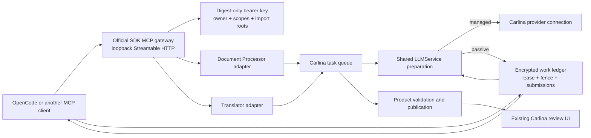

# MCP integration architecture

Last reviewed: 2026-10-06

Document Processor and Translator expose the same revision-fenced workflows
through the loopback gateway. Accepted model responses are distinct from final
publication. External MCP consumption remains deferred.

Documents defaults to a loopback listener and has administrator-only connection
setup in its home page. The full Workbench listener remains opt-in. Connection
keys are owner-bound, use fixed document/translation/work scopes and return the
bearer only once; status reflects the actual listener handle. The ledger records
source and installed-artifact acceptance separately.

## Decision

Carlina has two independent MCP roles:

1. **Product exposure:** one host-owned gateway exposes curated Document
   Processor and Translator workflows. A client can start ordinary
   Carlina-managed work or provide each model completion through a durable
   passive claim/lease/submit loop.
2. **External consumption:** a later broker will let Carlina call reviewed
   remote MCP servers through the shared execution-policy kernel.

Neither role turns an MCP server into a native add-on. Native add-ons retain
their Add-on API v1 authority; an MCP principal receives only its authenticated
protocol surface.

The canonical protocol is MCP `2026-07-28` (there is no `2026-07-26` release).
The server uses the official Python SDK and also supports its `2025-11-25`
legacy client mode for current harnesses. Product jobs and work items do not
depend on protocol sessions.

The official Python SDK 2.1.1 does not implement the experimental Tasks
extension. Carlina therefore does not advertise or imitate MCP Tasks. Long work
uses explicit durable tools (`carlina_job_get`, `carlina_job_cancel`,
`carlina_work_claim`, `carlina_work_release`, `carlina_work_renew`, and
`carlina_work_submit`) under both protocol eras. Tasks
can be added later as a projection when an official runtime supports them; they
must not become a second job system.

## Implemented system shape

The pilot uses a separate loopback Uvicorn listener in the managed process and a
single `/mcp` endpoint. The combined endpoint is intentional for the two-product
end-to-end flow: a client can process a document and then create a Translator
project without configuring two servers. Product tools still have separate
scopes and adapters. Split virtual endpoints remain a possible later catalog
optimization, not a prerequisite or a public add-on contract.

The Document Processor package registers all 27 tools through the shared typed
`McpToolRuntime` port: import/start/read/export, assembly recovery, issue tracking
and review/repair. Translator uses the same port for all 39 tools, grouped by
project/export, review/numbering/notes,
glossary and context responsibilities. That port carries verified authority,
context execution and normalized failures without importing a product. Existing
client, service and source-image callbacks are injected by the gateway. Both
products own execution startup, using the shared ledger and injected serialization;
Translator also owns deferred source-ingestion job association. Their gateway
startup callbacks are compatibility forwarders. Document preflight rejection
precedes durable admission; passive PDF startup retains the recovery contract and
initial queue ID through uncertain publication. Native image transport, bounded
edit-error serialization and shared job registrations remain gateway
responsibilities.
This is an internal composition boundary, not a public third-party registration API.

Documents packages with a verified source bundle expose their installed version,
revision, archive length and digest through `carlina_status.application`.
Discovery adds `carlina://application/source/<sha256>` to the passive guide and
resource catalog. Reading it requires MCP access but no product or passive-work
scope; it returns the same verified archive served by the public hash-bound HTTP
download. Missing legacy bundles advertise no resource, and tampering stops the
read. No request path can select a repository file or data-root content. This
application archive does not replace applicable native dependency source/notices.

## Execution model

An `McpExecution` is an owner-scoped projection that binds one product resource
to an optional queue delivery and one of two modes:

- `managed`: Carlina resolves an active model profile and provider credential,
  then performs provider I/O normally;
- `passive`: the client must declare the task-authorized
  `carlina.external-executor.v1` capability envelope. Carlina snapshots and
  revalidates that envelope, but neither identifies nor authenticates the
  external model, provider, or credential. The envelope controls capability
  admission and limits; only provider I/O is replaced by the external
  harness.

The user's extraction, translation or other passive task request authorizes
execution. Clients declare actual capabilities and limits; no separate literal
profile confirmation is required. The existing `user_confirmed=true` transport
field acknowledges task authorization. Frozen execution profiles and other
approval boundaries remain unchanged.

PDF vision extraction requires direct visual authoring by the executing model
from the supplied native page images. Embedded-text extraction, external OCR and
script-generated transcription/structure drafts require explicit user permission;
later visual review does not change their method. Helpers may render/crop images,
transport packets, validate model-authored output and package exports. Supplied
text/candidate catalogs remain navigation evidence. Instructions communicate this
requirement; schema validation cannot establish which authoring method was used.

The product worker remains the workflow authority in both modes. In passive
mode, the shared `LLMService` completes ordinary prompt/tool/schema hydration
and admission, and freezes the exact provider-neutral call as
`carlina.passive-completion.v2`. The packet contains messages, tool
declarations, response format, safe generation parameters, the normalized
executor envelope, a bounded workload role, and a fingerprint. It contains no
Carlina provider or model identity and strips ephemeral host `file_path` hints
while retaining the inline media bytes needed by the external executor.

The worker then:

1. creates or reuses the work item and commits it before yielding;
2. marks the execution `waiting_external` and retains the same queue delivery;
3. re-enters after a submission, reconstructs an ordinary LiteLLM response, and
   continues the existing product loop;
4. may emit another tool/model round as a new work item; and
5. alone performs parsing, validation, state mutation, and publication.

This means the harness supplies substantive model reasoning while retaining
Carlina's prompts, source preparation, model-role settings, tool loop, and
product validators. Harness-side subscriptions and arbitrary tools are outside
Carlina's audit boundary unless they call a separately governed Carlina tool.

## Durable job and work spine

`carlina_status.authorization` identifies the current key and its granted and
missing product scopes. The `products` field includes only authorized products;
an omission does not diagnose an inactive add-on. Missing authority returns a
bounded `insufficient_scope` tool error naming the required scope, including
checks performed before the product handler runs. Tool discovery itself does
not grant authority to invoke a tool.

The local operator may add explicitly named scopes to an existing owner/key pair
with `flask mcp grant-scopes --user-id ID --key-id KEY --scope SCOPE`. This keeps
the bearer digest, import roots and all existing permissions unchanged, refuses
revoked keys and concurrent modifications, and never prints bearer material.
Updates never silently add scopes to existing keys. News management requires
`mcp.news_pipeline`; script editing/diagnostics and publication additionally
require `mcp.news_scripts` and `mcp.news_publish`, respectively.

The root migration adds:

- `McpAccessKey`: owner-bound status and scopes, encrypted label/import roots,
  digest-only bearer verification, last use, and revocation;
- `McpExecution`: product/resource identity, mode, queue binding, request, and
  coarse projection status;
- `McpWorkItem`: encrypted active request, durable request fingerprint, state,
  attempt/fence version, claimant, lease token/expiry, accepted response, and
  request-redaction timestamp;
- `McpWorkSubmission`: append-only encrypted accepted/rejected/duplicate
  attempts and bounded diagnostics.

Claims are owner- and add-on-scope filtered, may be restricted to one exact
execution, and use a conditional update so one claimant wins. A release, renew,
or submit must present the exact unexpired current lease token and fence.
Expired work is reclaimable; stale claimants cannot publish. Cancellation
first resolves the authoritative product cancellation/terminal race, then
atomically terminalizes the execution and all unfinished work. Repeating
an identical completed response is idempotent, while different late content is
recorded and rejected. Response validation bounds content, tool calls,
arguments, finish reasons, usage, and declared JSON-schema output.

The source submission contract also accepts native objects/arrays in
`response.content` for declared JSON formats. Carlina encodes them once, checks
the same schema and byte limits, and stores the ordinary string completion.
Existing string completions retain their bytes. Identical native-object retries
remain idempotent after request redaction. `json_object` requires an object root;
malformed or double-encoded strings are not silently repaired. The live release
boundary remains recorded in the ledger; clients must discover the supported
submission schema rather than infer it from this source contract.

Submission rejection feedback identifies bounded JSON Pointer paths, validator
keywords and expected schema values without echoing completion values or raw
validator messages. Required-property errors point to the missing field, including
nested fields. A rejected completion retains its current lease until expiry;
the response reports whether that lease is still active. `work_submit(dry_run=true)`
performs the same scope, lease and schema checks without recording a submission,
accepting output, changing the work item or waking product work. Correct a payload
under the existing active lease. All work kinds, including document metadata,
share `work_release(work_item_id, lease_token, reason)` and are immediately
reclaimable after release.

Successful submission and preview receipts identify
`validation_stage=response_contract` and `product_validation=not_checked`.
They do not certify extraction semantics. Compact claims include submission
guidance even when the prepared completion has no tools, without altering frozen
messages, image bytes or request fingerprints.

After an accepted submission, Carlina replaces the encrypted request packet
with a small encrypted tombstone while retaining its fingerprint, accepted
response, dispatch identity, and append-only submission audit. Completed replay
therefore remains idempotent without retaining base64 page images indefinitely.
Execution terminalization fences active claims and performs bounded cleanup;
the operator command can redact older terminal rows in bounded batches.

Execution envelopes remain limited to 512 KiB. Passive work packets allow up to
144 MiB so PDF page images fit after base64 expansion. A claim converts embedded
data-URL images to native MCP `ImageContent` blocks. Work images follow the
selected serialized-response budget below, including base64 expansion; source
review attachments retain their separate 25 MiB per-image and 100 MiB total caps.
Submitted assistant responses remain deliberately much smaller.
Ephemeral local paths are removed before packet fingerprinting and persistence.
The claim's textual projection uses `carlina-mcp-image:N` references instead of
repeating encoded image data; the corresponding image blocks carry the bytes.
This remains the bounded-batch transport: resource links would require a separate
client retrieval contract, and local paths would require a shared filesystem.
Admission counts images separately from text and does not tokenize base64 bytes.

Work delivery additionally enforces an 8 MiB default response-byte budget,
independent of model-context admission. Oversized packets return a small receipt
and immutable references; `work_get(image_offset, image_limit)` returns native
images in ordered batches that fit the chosen budget, without downsampling or
changing the original completion contract. Text/schema fields remain available
through paginated request paths. A single oversized image fails explicitly.
See [delivery details](extraction-efficiency.md#delivery-bytes-and-recoverable-claims).

An optional `claim_request_id` binds a successful claim to its authenticated
access key, execution, selection arguments and lease attempt. The durable receipt
commits atomically with the lease; replay recovers only that same still-active
attempt without renewal or a new claim. Conflicting or closed request IDs fail
explicitly, including after release, expiry, reclaim, submission or cancellation.
Receipt records retain no document content or lease token. Transport projections
may change on replay while the original work remains frozen. This makes lost
responses recoverable; it does not pretend that server-side serialization proves
that a downstream client received or inspected an image.

## MCP surface

### News Pipeline

News Pipeline exposes owner-scoped pipeline/source management, paginated source
and summary reads, revision-fenced edits and editorial decisions, source tests,
run diagnostics, and explicit WordPress publication through `carlina_news_*`.
The product scope is `mcp.news_pipeline`; passive claims also require `mcp.work`.
Existing keys are not expanded automatically. Writing/testing saved Python
scraping scripts requires the additional `mcp.news_scripts` scope: these scripts
are trusted host code. Publication requires `mcp.news_publish` and an approved
or previously published item with a nonblank summary and current revision.
Approval does not publish. Editing a published summary changes local data until
an explicit republish uses the existing source-bound digest idempotency contract.

`carlina_news_start` queues one active MCP run per pipeline. Passive starts use
the declared external executor envelope, without selecting a managed model.
The supervised news worker uses the existing collection/fallback path, freezes
the selected editorial settings and fetched evidence in encrypted execution
state, then prepares sequential batches (default five, maximum twenty articles).
Evidence is bounded to 8 MiB per run. Shared admission can split oversized groups
or chunk a single article. Claimed assessment packets declare exact expected
article IDs; packet-local preflight rejects missing/duplicate/foreign IDs and
blank success summaries without consuming the lease. The worker still validates
before committing product rows. Chunk completions retain their own schema.

Re-entry reuses frozen evidence and submitted completions rather than scraping
again. Each committed batch and its cursor advance atomically behind the active
execution fence; collection writes use the same fence, and cancellation fences
outstanding work before signalling the queue. Active add-on startup ensures a
worker so retained jobs resume after a host restart. Terminal runs discard the
temporary evidence checkpoint. A process death
during initial collection can require collecting again; source reads are not
claimed to be exactly-once. Initial collection keeps its live/archive fallback;
model-reported blocks after freezing become reviewable rejections, with explicit
source diagnosis and manual correction instead of replacing evidence mid-batch.
Existing URL deduplication remains: another collection does not automatically
regenerate previously stored rejected articles.

Successful summaries enter `pending_review`; preparation completion is separate
from editorial approval and publication. `carlina_job_get` distinguishes accepted
model work from committed batches. `carlina_news_runs` returns bounded safe
ledger counters/events, while `carlina_news_source_diagnose` performs explicit
network tests and returns bounded listing/content evidence without saving items.
Script failures include safe exception classes and script line numbers, without
raw provider messages or local paths.
Pipeline sharing tokens and provider secrets are not part of this surface.

### Shared and document tools

The current catalog is deliberately small:

- discovery/status: `carlina_status`;
- Document Processor: `carlina_document_import`,
  `carlina_document_configure`, `carlina_document_start`,
  `carlina_document_get`, and `carlina_document_list`;
- extracted-document exports:
  `carlina_document_export` and `carlina_document_export_get`, with reviewed-text
  revision fences, stable retry keys, and bounded artifact retrieval;
- completed-extraction review:
  `carlina_document_review_outline`, `carlina_document_review_inventory`,
  `carlina_document_review_search`,
  `carlina_document_review_fetch`, `carlina_document_review_boundaries`,
  `carlina_document_review_apply`, `carlina_document_review_notes`,
  `carlina_document_review_history`, `carlina_document_review_undo`, and
  `carlina_document_source_pages`;
- source note relationship repair:
  `carlina_document_review_note_references` and
  `carlina_document_repair_note_topology`; see
  [local note sequences](extraction-efficiency.md#local-note-sequences-and-relationship-repair)
  for exact marker witnesses, explicit promotion/link operations and undo;
- Translator execution: `carlina_translator_create`,
  `carlina_translator_start`, `carlina_translator_get`,
  `carlina_translator_configure_batches`, and `carlina_translator_list`;
- Translator document exports (deployed):
  `carlina_translator_export` and `carlina_translator_export_get`, using stable
  retry keys and exact operation IDs for bounded artifact retrieval;
- live terminology: `carlina_translator_glossary_get` and
  `carlina_translator_glossary_propose`, separate from preparatory dossiers;
- Translator review: `carlina_translator_review_outline`,
  `carlina_translator_review_fetch`, `carlina_translator_review_search`,
  `carlina_translator_review_source_pages`,
  `carlina_translator_qa_diagnostics`, `carlina_translator_review_explain`, the three
  `carlina_translator_reader_note_*` lifecycle tools, and
  `carlina_translator_research_dossier_submit`, and
  `carlina_translator_target_update`;
- durable orchestration: `carlina_job_get`, `carlina_job_list`,
  `carlina_job_cancel`, `carlina_work_claim`, `carlina_work_release`,
  `carlina_work_renew`, and `carlina_work_submit`.

Discovery also exposes:

- `carlina://guide/passive-work` with the authoritative worker loop;
- an owner-checked `carlina://executions/{execution_id}` resource template; and
- `carlina_passive_worker`, a prompt for a generic harness agent.

Tools return bounded structured results. `carlina_document_get` may optionally
return the complete semantic output. The review tools provide bounded text and
element retrieval without sending the whole book or embedded images each time.

Ordinary orchestration uses compact projections. Document start acknowledges the
execution and batch count without echoing the plan/settings. Work claims retain
the exact messages, tools, response format and generation parameters, plus the
lease and work identity. The schema appears once in `request.response_format`;
owner/queue bookkeeping, a second schema copy and the repeated executor envelope
are omitted. `include_details=true` on start/claim restores the diagnostic view.
Translator retry identity and bounded validator codes remain in
`request.dispatch.translator_window_retry`, including reduced claim views, so
an external worker receives the feedback needed for correction.
Use a standard claim first for each worker/stage and read its exact leased
messages, schema, and required context before authoring. Prefer the native
compact projection for later claims only while the executing model still holds
the matching instructions; a matching hash or wrapper cache is not proof of
model context. After compaction, transfer, restart, hash change, or uncertainty,
retrieve and read the omitted contract/context with `carlina_work_get` under the
same work item and lease. A wrapper must forward omission notices, hashes,
retrieval paths, and `request.dispatch.extraction_contract` when present. Reduced
claims preserve that versioned summary without synthesizing it for retained
packets that do not contain it. Wrappers must deliver the summary into the
executing model's context; keeping it only in wrapper/script memory does not
satisfy the contract.
The canonical persisted packet and its fingerprint are unchanged. Submission
acknowledgements omit the completion body unless `include_response=true`.
Document discovery returns compact identity/status rows with `offset`/`limit`
pagination (default 20, maximum 100); `document_get` supplies full metadata and
effective settings when needed.

`job_get` returns execution/product state and `batch_summary` counts, without all
batch rows or their boundary context. `include_batches=true` opts into records,
paged with `batch_offset` and `batch_limit` (default 20, maximum 100), alongside
the same overall counts. Review handoffs return a path and figure/page counts;
`include_details=true` opts into full review page lists and instructions.
Completion counts describe batches, not independent
visual/transcription acceptance or the inclusion of every page in final output.

Document batch polls distinguish `validating` (response accepted, product
checkpoint pending), `completed` (validated checkpoint or successful execution),
and `unverified` (terminal work without retained validation evidence). Downstream
unattempted batches are `blocked`, rather than individually failed. A document's
current execution identity fences checkpoint and error projection: polling an
earlier run cannot inherit a later run's progress or terminal state. The later
document state is labelled separately when identities differ.

Compact document reads expose checkpoint page/batch counts, without partial page
text or images. New passive starts reject an existing partial checkpoint unless
`restart_from_scratch=true` explicitly permits discarding it. This protects saved
work. New passive PDF executions retain an encrypted recovery contract with the
original source digest and prompt settings. Known renderer/process transport
failures suspend the same execution; completed responses and page checkpoints
remain available. `suspended` is nonterminal but cannot claim or submit work.
Suspension invalidates outstanding leases without redacting their requests.

`carlina_job_get` exposes recovery eligibility, reason, preserved work/page counts,
and the next call. Use `carlina_job_resume(execution_id, idempotency_key)` with a
new key for each suspension; repeat the same key after uncertain delivery. Resume
checks ownership, source bytes, retained settings and current bindings, reserves
a new queue attempt on the same execution, and dispatches through an atomic,
idempotent queue receipt. Both initial starts and resumes retain their queue
intent before dispatch; polling reconciles an intent if dispatch was interrupted.
A queued job with no delivery exposes `delivery.pending`, its blocker, and a
`carlina_job_get` call instead of claiming to wait for an external response.
Old keys return their historical receipt without restarting a later suspension
or a terminal execution. The document card's Resume action uses this same service;
pausing a frozen passive extraction suspends it through the same durable contract.

Validated page state consumed since the last ordinary checkpoint is saved on a
rendering failure. A fresh parser can also replay retained accepted responses
by exact packet fingerprint. A changed packet at a retained completion position
stops recovery before issuing replacement work; the recovery reason identifies
the affected batch/page where available. Validation may request a corrected
packet after consuming the retained response. Missing or changed source files
and changed settings block recovery without discarding progress. Terminal
cancelled/failed executions, including historical runs without recovery proofs,
are never reopened. Reconnecting to an active execution continues its existing
durable replay path.

The suggested external-executor input budget is 256,000 tokens, with actual
limits still explicitly declared; existing executions retain their
snapshots. Before a new passive PDF is queued, metadata preflight rejects an
initial window whose image-token lower bound alone exhausts the declared input
budget. It uses source-wide metadata scope, explicit exclusions, and the union
of start/end windows. At 8,192 tokens per image, 20 images need at least 163,840
tokens before prompts/schema. This fast check does not render images or replace
full packet admission, which also governs expanded evidence windows.

### Completed-extraction review

The review surface reads the completed semantic document. It does not replay
extraction, change a running translation, or automatically decide which printed
words/headings are errors.

1. Read every page of `review_outline`, including all heading levels. Besides
   level jumps and empty headings, advisory hints identify ordinal-only headings,
   possible run-in prose and repeated question headings. These are candidates:
   a numbered clause or Q&A prompt can legitimately be a heading. Use surrounding
   text and the source, not visual prominence or punctuation alone.
2. Use `review_search` with strict boolean `case_sensitive` and optional
   `whole_word`. Results echo `search_options` and the actual `matched_text`.
   `total_matches` counts matching elements, not occurrences; nearby context is
   not filtered and may contain other capitalization. Search folds case only when
   requested; it does not normalize spelling. Word boundaries use Unicode letters,
   combining marks, numbers and connector punctuation. Inflected/compound forms
   therefore do not match a shorter whole-word query. `review_fetch` gives bounded
   complete editable HTML. Search whitespace is normalized; edit matching is not.
3. Follow all `review_notes` pages and inspect individual note bodies and their
   reference diagnostics. Check `review_boundaries`, including joins inside one
   paragraph. Omitted page markers alone do not establish a missing source page.
   Treat unresolved splits or unreviewed notes as pending work, not completion.
4. Request physical PDF pages with `document_source_pages` or a selected boundary's
   `include_images=true`. Source pages are 1-based physical positions, not printed
   page labels. `include_review_context=true` pairs images with current heading
   IDs and a revision fence. Each page shows at most 40 headings, with explicit
   omission counts and an `outline_next_offset` for more evidence. The default
   source-only mode also works before extraction is complete.
   **Clients must forward native MCP image blocks to the vision-capable model.**
   Serializing the returned object/base64 as text does not provide vision.
   `image_delivery.model_visibility=not_verified` is deliberate: the server can
   prove that it sent images, not that a model inspected them. Report unavailable
   visual review honestly. Native image delivery is not a new thumbnail-panel UI.
5. Apply 1-50 edits atomically with `review_apply`. `demote_heading=true` converts
   a heading to an emphasized paragraph while preserving IDs and inline content;
   it does not merge a broken sentence. `replace_texts` groups 1-50 literal
   replacements within an element; repeated legacy `replace_text` edits on that
   same element are also allowed when their matched spans are disjoint. All match
   counts and spans refer to the original reviewed snapshot, never intermediate
   output. Replacements cannot cross links, page anchors, images or block boundaries.
   Protected inline text still participates in whole-word boundaries. Other edits
   change a heading level, replace fetched HTML/sibling ranges, or delete an
   element guarded by its exact normalized text. Existing protection remains.
   Text/edit preparation failures return bounded per-edit diagnostics with element
   ID, zero-based edit/replacement indexes and expected/actual counts. Overlaps
   identify the conflicting edit. A rejected batch never partly saves. `dry_run`
   previews without publishing; previews are serialized differences, not editable HTML.
6. Re-fetch current evidence after each save. `document_get` refreshes the owned
   record and returns `revision`; full output also returns `output_revision` and
   `output_origin=current_completed_record`. `expected_revision` rejects stale
   reads. Reusing an earlier response/export is still stale even if its filename
   is unchanged. Completed edits retain the existing atomic HTML/Markdown/knowledge
   and encrypted undo transaction. Default `whole_word=false` is omitted from
   retry hashing to preserve pre-existing request hashes.
7. For systematic close-out, paginate `review_inventory` on the **final revision**.
   It lists distinct visible Unicode tokens, occurrence counts and bounded
   element/page witnesses for body, headings and notes. Long tokens are explicitly
   flagged for element fetch rather than silently discarded. A spellchecker such
   as an external Hunspell run can use this fresh evidence; no dictionary is bundled
   and no spelling is changed automatically. Worker self-reports are another useful
   candidate channel. Verify candidates visually and preserve print-faithful oddities.
   Coverage totals inventory the source, not the reviewer's progress:
   `review_completion=not_tracked`. Record reviewed ranges, remaining flags and
   unavailable visual checks explicitly. A handful of zero-hit searches does not
   establish that every folded form was found.
8. Review metadata marked stale by edits and regenerate exports in the app or
   through `carlina_document_export` using the fresh revision and a new retry key.
   Downloaded exports and existing Translator source snapshots stay unchanged.
   `review_history` and `review_undo` retain the existing bounded, latest-only,
   revision-fenced undo behavior, not automatic rebasing or redo.

Native JSON completion values are encoded once as UTF-8. Valid pre-encoded JSON
strings retain their original bytes, including valid Unicode escapes. Invalid
surrogates are rejected even when hidden inside JSON escapes, with encoding
rather than transliteration guidance. A string supplied where the response
schema requires an object/array receives a possible-double-encoding explanation;
legitimate string schemas remain valid. Never ASCII-fold source spelling to work
around submission errors. Existing issued packets and accepted output are not
rewritten by these validation changes.

Every review response includes a SHA-256 revision covering stored output and the
`carlina.document-review.v1` indexing contract. Bump that contract when changing
element indexing so cached IDs cannot silently address another element. IDs are
deterministic only within that revision; they are not injected into the HTML.
Pass `expected_revision` when paging/fetching to reject changed evidence. Saving
requires that revision and an idempotency key, and conditionally updates the
owner's completed row using its observed modification timestamp. Semantic HTML,
derived Markdown, knowledge publication, encrypted undo history, and the retry
receipt commit together. No-op edits record retry receipts without publishing
another knowledge version or marking previously fresh metadata stale.
The last 32 retry receipts retain keys and hashes only, never plaintext edits.
An old key with a different payload is rejected; an identical retained receipt
returns its applied revision without applying again. Beyond this receipt window,
the caller must read fresh state before attempting further edits.

Undo stores inverse serialization splices in authenticated installation-key
envelopes under private document settings, bound to owner, document and both
revisions. No plaintext fragments enter the JSON settings column or ordinary
document DTOs. Unique-chunk patience anchors bound diff computation; unusually
large unanchored gaps require smaller batches rather than unbounded diff work.
Each inverse delta is capped at 256 KiB; history retains at most 32 entries and
1 MiB encrypted per document, evicting oldest entries. Undo verifies exact prior
HTML bytes, revalidates semantic markup and uses the same conditional save and
knowledge-publication transaction. This is bounded recovery, not permanent
document versioning. Existing historical edits have receipts but no retroactive
undo record. A changed review indexing contract invalidates old undo revisions.

Search is literal rather than arbitrary regex or shell execution. Pagination
uses `next_offset`; fetch emits complete elements within a 64k HTML-character
budget. Large containers can be inspected through smaller descendant elements.
Search/context HTML has a separate shared 64k-character budget, with complete
fragments up to 8k each. Note inventory has a 128k-character response ceiling,
including bounded references/backlinks and at most 16k of diagnostic hints;
follow `next_offset` even when fewer than the requested number of notes fit.
Physical-page filters use retained element provenance, not inferred note location:
unknown-page note bodies remain discoverable with `scope="notes"` and no page
filter, while their reference elements carry available physical provenance.
Read/edited documents are limited to 20 MiB and an edit request to 256 KiB. Page
references describe retained extraction markers, not printed page numbers; a
gap in those markers can mean intentionally omitted output and is not evidence
that source pages are missing. Unmapped endnotes retain unknown page provenance.
Legacy output can be inspected through a read-only normalized view; scoped edits
require the current completed semantic contract so they cannot silently normalize
unrelated legacy content. The existing whole-document HTTP editor remains a
separate interface; the revision/retry protections described here apply to MCP.

### Extracted-document export

`carlina_document_export(document_id, expected_revision, idempotency_key, format)`
packages a completed extraction as `epub` (default), `docx`, `pdf`, `html`, or `md`.
Read the current review revision with `carlina_document_get` first. Admission and
worker execution both check completed status and that exact text revision.
An edit before rendering causes failure rather than packaging different text.
The worker copies the checked row and saved metadata into transient objects before
progress updates can commit/expire its session. Later source edits remain saved
for the next export. Resources use the existing exporter's behavior; the review
revision fences HTML, not a separate immutable metadata/resource snapshot.
`start_h2_on_new_page=true` is available for DOCX/PDF. Export makes no model call.

The existing Document Processor queue and renderers are authoritative. The initial
enqueue commits the export identity and delivery atomically. An owner/document/key
identifies one exact operation; identical retries, including reconnects after later
edits, return that operation. Reusing its key with different revision/format/options
fails. Use a fresh revision and a new key to export corrected text or retry a failed
render. Source documents, extraction responses and Translator snapshots are unchanged.

Poll the returned `operation_id` with `carlina_document_export_get(document_id,
operation_id)`. The default response supplies readiness and, when ready, filename,
media type, byte length, revision and SHA-256 without file bytes or server paths.
With `include_content=true`, retrieve Base64 chunks of 1–65,536 bytes using
`offset`/`limit`, follow `next_offset` until `eof`, and pin `expected_sha256`.
Verify each `chunk_sha256` and the assembled file's length and full checksum.
Completion and verified download are separate evidence.

MCP artifacts are atomically published under the data root's per-operation export
directory rather than system temporary storage. Reads validate the exact queue,
owner, document and artifact records; path traversal, symlinks and nonregular files
are rejected. As with Translator's secure chunk reader, platforms lacking no-follow
directory-descriptor access fail closed. These tools require `mcp.doc_processor`.

## End-to-end flows

### Document Processor

1. Import a regular same-host file from a key-authorized root.
2. Configure validated Document Processor settings.
3. Start with `mode="managed"`, or for passive mode declare the executor
   envelope and an orchestrator-authored `carlina.document-batches.v1` plan,
   state the actual limits and capabilities, and pass both to the start tool.
   The task request supplies authorization; no separate profile confirmation is needed.
4. Poll the execution and, in passive mode, drain work items by passing the
   returned `execution_id` to every claim.
5. Passive PDFs skip initial crop review and use the full page; if later
   image-coordinate review is required, complete it in the existing Carlina UI
   and continue polling.
6. Read the completed document projection/output.
7. Export its reviewed revision with `carlina_document_export`, poll the exact
   operation, then download and verify bounded chunks with `carlina_document_export_get`.

The source adapter canonicalizes and authorizes the path, opens without
following a final symlink where the platform supports it, verifies the opened
file identity, and streams a bounded copy into add-on-owned storage. Arbitrary
paths, URLs, inline large files, and MCP Roots are not accepted in the pilot.

The execution marker is persisted with document settings so a UI-triggered
resume after review re-enters the same passive execution rather than silently
calling a managed provider.

### Translator

1. Create a document project from a completed, strictly attested owner-scoped
   Document Processor document. Inline text creation is not supported.
2. Carlina deterministically freezes the semantic source plan; then start its
   `document-block-v1` translation with the managed/passive choice. Passive
   starts require the declared, task-authorized executor envelope and no Carlina provider.
3. Poll the execution and drain leased block-window completions when requested.
   Each returned result passes the same structure, source-identity, wrapper,
   note, and publication validators as managed execution.
4. Read the safe projection and, after completion, optionally retrieve verified
   semantic target HTML.
5. Where advertised, start `carlina_translator_export` with saved edition metadata,
   then poll its exact operation through `carlina_translator_export_get`. Retrieve
   base64 chunks and verify the assembled file against the creation length and
   SHA-256 witness. This uses the existing product export operation without an
   `McpExecution`, a model call, or browser-session authentication. See the
   [Translator contract](translator.md) for artifact isolation and chunk rules.

Creation accepts normalized language names/tags and the closed creation-settings
schema; returned runtime bindings and derived settings are not creation inputs.
Polling selects the requested execution's owned project/queue; historical runs
retain their state when a project is reused. `waiting_external` means an owned
work item in that exact run is pending or leased.
After acceptance, `running` includes local validation and finalization. Acceptance
is not proof of target publication; see the [Translator contract](translator.md).

New Translator starts freeze the verified active target/alignment pairs and an
explicit pending-block scope, using the same continuation contract as the HTTP
route. After a failed, partial, or cancelled translation, starting again creates
a fresh recovery operation that excludes those protected blocks. The earlier
operation and its accepted work remain intact. Repeated starts of an existing
successful operation reuse its frozen configuration rather than resnapshotting
or retranslating completed blocks.

Timed Subtitle Studio translations retain the internal `segment-v1` engine but
are not exposed by the document Translator MCP tools. Migration 022 deletes all
pre-block Translator project aggregates rather than preserving an ambiguous
document compatibility path; source Document Processor and Subtitle Studio
rows remain outside that aggregate.

## Authentication and transport

The gateway is disabled by default and can bind only a numeric loopback address
or `localhost`. It refuses the main Flask port. The official SDK owns protocol
negotiation, discovery, legacy session/SSE compatibility, schemas, and
Streamable HTTP framing; Carlina does not hand-roll JSON-RPC.

Every request requires an opaque bearer key with `mcp.access`. Product and work
tools additionally require `mcp.doc_processor`, `mcp.translator`, or `mcp.work`.
Actor and owner come only from the verified credential. Raw bearer material is
shown once, never stored, never accepted in a URL, and never placed in a review
link. Source imports are restricted to roots frozen into that key.

Product admission carries that owner in its trusted queue `user_id` field. The
durable queue status passes it explicitly to the best-effort runtime job mirror;
background or polling login context cannot assign or replace it. Mirror ownership
is immutable at row creation, including an unknown owner, and conflicting queue
sources are rejected. This projection supplies operational visibility, while the
MCP execution and product records retain authority. Existing ownerless mirrors
are not backfilled by a later login or update.
Translator delivery writes the admitted project, owner and operation IDs after
merging operation-specific fields, so those fields cannot replace ledger identity.

This bearer profile is intentionally local-only. Remote publication requires
TLS and the MCP HTTP authorization profile (protected-resource metadata,
authorization discovery, OAuth 2.1/PKCE where applicable, resource indicators,
audience validation, scoped/revocable tokens, and deployment threat tests).
The existing reverse tunnel must not publish the MCP listener.

Automated acceptance covers discovery/authentication, owner/import-root isolation,
concurrent claims, lease fencing, replay/idempotency, validation and passive
Document Processor/Translator flows. Use isolated roots and the affected offline
lane; real-provider compatibility and whole-book linguistic review remain separate
acceptance. Private deployment history and receipts stay with the consuming app.

## Agent-friendly document batches

Multipage requests expose validation feedback and discoverable submission schemas.
Cross-execution recovery must use the explicit supported recovery contract.
Clients must still discover the supported submission schema rather than infer
it from this source contract, and a stale client catalog can hide current
server capabilities until it is refreshed/reconnected.

Long documents should not require one model context to survive the entire book.
Before page extraction fans out, Carlina creates one immutable,
hash-addressed document-context artifact containing the accepted metadata,
heading/TOC evidence, page topology, crop/page map, extraction policy, and source
hash. Metadata extraction may be executed
by the parent harness or leased as its own work item, but the resulting artifact
is frozen before dependent page batches become claimable.

`carlina_document_start` accepts an optional
`carlina.document-batches.v1` plan containing `scheduling_mode` and ordered,
non-overlapping, one-based page ranges. Carlina assigns sequence/dependency
metadata but never chooses range size: batch size and count remain orchestrator
decisions. The plan is immutable in the execution request; its effective ranges
must cover every selected source page.

Two scheduling modes should share that representation:

- `sequential`: work for a dependent batch is not created until its predecessor
  has completed. An accepted batch
  emits a compact boundary handoff—open paragraph/list/table/footnote state,
  active headings, contributor context, and bounded preceding HTML—which the next
  batch receives. A fresh agent can therefore continue without inheriting the
  previous agent's full conversation.
- `concurrent`: independent batches receive the same document-context artifact
  plus small source-evidence halos around their edges. Every page in a range is
  supplied together, so the model can inspect within-batch continuity.
  When visual boundary correction is enabled, ordered boundary-reconciliation
  work reviews adjacent outputs before assembly. No parallel agent pretends to have another
  batch's unavailable generated context.

Visual boundary correction (`llm_boundary_merge`) is opt-in, including the Book
quality profile. An explicit saved choice survives profile normalization and
reentry. Without that pass, ordered assembly uses directional extraction classes
and conservative text evidence. Sentence punctuation alone never vetoes a marked
continuation; explicit title/header structure does. When correction is enabled,
an accepted `separate` decision vetoes continuation hints. A container-level
`merge` does not force its new child paragraphs/items/rows to merge: split
children require their own continuation evidence. A distant jacket-flap fragment
is not evidence of continuation from the adjacent scanned page.

New starts freeze `mcp_page_batch_protocol=carlina.pdf-page-batch.v1` in the run
settings. Each extraction request carries all missing pages in its declared
range as individually labelled images, plus accepted metadata in the model
messages. It requests one JSON object with a `pages` array of
`{"page_number": 1, "html": "<main_content>...</main_content><footnotes>...</footnotes>"}`
entries. Exact ordered page coverage is required: duplicate, omitted, extra,
reordered, or malformed entries are rejected. The existing semantic and source
grounding checks still validate every page. A batch is checkpointed only after
all pages and any optional page evaluators finish; suspension replays accepted
completions without publishing an incomplete batch. Outstanding validation
retries take precedence over accepted terminal work in batch-status projection.
Existing executions without the marker retain their original single-page packet
format and fingerprints.

New source starts additionally freeze `mcp_batch_feedback=validation-v1`.
Validation retries identify the batch, physical page, validation stage, fixed
content-free advice and attempt count. Exhaustion persists the same bounded
diagnosis through worker rollback so `job_get` can expose it. Older executions
keep their exact retry messages for replay. Atomic batch publication and all
semantic/grounding thresholds are unchanged; response-contract previews do not
claim to run these later product checks.

New passive starts freeze `mcp_metadata_policy=budgeted-v1`. Required primary
metadata errors stop preparation before dependent page work. The configured
initial metadata window is never silently truncated. Clients must size it for
the executor; conservative admission budgets 8,192 tokens per high-detail image
plus prompt/schema text. Use 256,000 input tokens by default when preparing a new
executor profile, honoring explicit smaller limits and actual executor capacity;
the API still requires an explicit envelope with task authorization.

Optional TOC expansion is reduced to an admitted window without removing the
primary window. Heading discovery starts with at most four representative
full-resolution pages plus the existing contact sheets and native locator
catalog. Each follow-up is measured before work creation; excess newly requested
pages, contact sheets and locator candidates are bounded without dropping pages
from an accepted round. Recoverable admission and structured-response failures
retain the last validated metadata/heading result as provisional; recognized
local timeout/connection exceptions are also eligible for this fallback.
Cancellation, authorization and unexpected internal failures still fail closed.
Explicit failure or cancellation of the whole external execution is terminal;
this policy does not revive it or add a new per-work failure/retry protocol.
An external executor that cannot fulfill work still releases it for reclaim;
release is not a failed response and does not automatically skip refinement.
`mcp_metadata_complete` distinguishes finished preparation from preliminary
metadata during replay. Executions without the policy marker keep their prior
packets and failure behavior.

`document_get` and job projections expose at most twelve content-free
`metadata_preparation` entries: stage, outcome, fixed reason code, and bounded
requested/admitted/declared token counts with output and schema measurements.
These are preparation outcomes, not proof of page semantic correctness. Terminal
workers update the document and matching execution atomically, fence unfinished
work, and reject late failures after the job/execution binding changes. Terminal
preflight failures before job-marker publication compare the exact inspected
document revision, status and settings, retaining the execution fence. A late
enqueue-marker write cannot restore an active binding to a terminal document.
Terminal
document status takes precedence over a stale queue result. Metadata and heading
work replay through the same durable completion ledger. Passive rendering uses
the complete page even when an earlier managed run saved crop boxes.

New passive starts also freeze `mcp_image_transport=png-2000-v1`. Their page
images use lossless PNG and a maximum 2,000-pixel longest edge, including a final
dimension check after rasterization rounding. An already suitable PNG passes
through without decoding or re-encoding. Metadata/edge previews retain their
1,400-pixel width cap; extraction retains the complete page width within the
2,000-pixel envelope. This avoids the previous PNG-to-JPEG step and client-side
resizing/PNG transcoding when the client accepts 2,000-pixel images. Existing
executions without this image marker retain their original 2,048-pixel target
and JPEG quality 95 for extraction or 88 for metadata, so accepted completions
keep replaying under their original fingerprints. Managed encoding and crop
behavior are unchanged.

Every extraction/evaluator packet carries a `carlina.passive-dispatch.v1` envelope with
batch/range/unit identity, dependencies, the shared context hash and encrypted
artifact, and any boundary input. The terminal-unit marker follows the actual
last completion in the page pipeline: the parser when evaluation is disabled,
or the evaluator when it is enabled. `carlina_work_claim` accepts `batch_id` only
with an exact `execution_id`; `carlina_job_get` exposes bounded batch states,
counts, hashes, and handoffs without returning prompts or accepted model output.
The external parent decides whether to reuse one agent, spawn fresh sequential
agents, or fan out concurrently. Cancellation fences all unfinished work in the
execution.

Passive PDF suspension now checkpoints accepted page HTML, current rendered
pages, batch boundaries, and metadata before deferring the queue delivery. A
replay resumes at the durable page frontier instead of rebuilding every accepted
page from page one. Immutable plans live in the encrypted execution request
while active, and dispatch/artifact evidence lives in the encrypted work ledger.
A narrow schema migration adds lightweight dispatch index columns so claims and
status projections do not decrypt historical image packets. After accepted
submission, the durable fingerprint and accepted response become authoritative
and the image-heavy request is redacted.

Focused tests cover plan validation, arbitrary range sizes, dependency gating,
concurrent fan-out, exact batch claims beyond the pagination window, shared
context hashing, packet propagation, terminal projection, and page-wave
checkpointing. Synthetic real-parser/ledger tests cover metadata and heading
claims before page work, metadata in batch prompts, fresh-parser replay,
multi-image requests, full-page rendering with saved crops, optional evaluator
replay, atomic semantic-validation retries, extraction image dimensions, and
pre-packet metadata admission rejection. A representative whole-book differential
run remains the acceptance gate for language/structure quality and cross-batch
boundaries.

## Deferred boundaries

- MCP Tasks until the official SDK implements the extension;
- split per-product virtual endpoints and a public add-on MCP adapter contract;
- stronger audit/event projections and automated retention policy;
- chunked completed-artifact resources and remote upload/import;
- remote OAuth exposure; and
- the separate external MCP consumer broker, local `stdio`, MCPB, and registry
  acquisition.

The public add-on exposure contract should be extracted only after the two
pilots and at least one smaller product demonstrate which interfaces are stable.
MCP-as-add-on remains a separate later decision.

## Acceptance scope

The [implementation plan](implementation-plan.md) owns the next executable phase;
the [ledger](project-ledger.md) owns current results and remaining limits. Preserve
the accepted corpus, output identities and recovery receipts during decomposition.
Use isolated synthetic roots for reconnect, lease-expiry, duplicate-submit and
managed differential checks. Bounded real-provider behavior remains separate from
synthetic passive completion and whole-book linguistic review.
