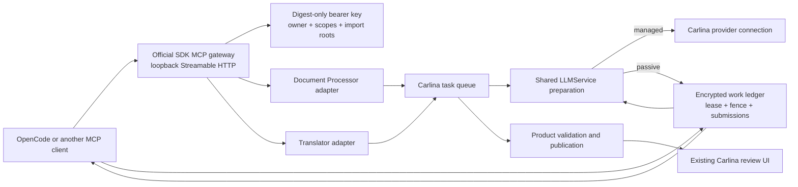

# MCP integration architecture

Last reviewed: 2026-10-06

Document Processor and Translator expose the same revision-fenced workflows
through the loopback gateway. Accepting a model response is a separate step from
final publication. External MCP consumption remains deferred.

Documents defaults to a loopback listener. Only administrators can set up
connections, from its home page. The full Workbench listener remains opt-in.
Connection keys are bound to their owner, use fixed document, translation and
work scopes, and return the bearer only once. Status reflects the actual
listener handle.

## Decision

Carlina has two independent MCP roles:

1. **Product exposure:** one host-owned gateway exposes curated Document
   Processor and Translator workflows. A client can start ordinary
   Carlina-managed work, or it can supply each model completion itself through a
   durable passive loop of claim, lease and submit.
2. **External consumption:** a later broker will let Carlina call reviewed
   remote MCP servers through the shared execution-policy kernel.

Neither role turns an MCP server into a native add-on. Native add-ons keep their
Add-on API v1 authority. An MCP principal receives only its authenticated
protocol surface.

The canonical protocol is MCP `2026-07-28` (there is no `2026-07-26` release).
The server uses the official Python SDK and also supports that SDK's `2025-11-25`
legacy client mode for current harnesses. Product jobs and work items do not
depend on protocol sessions.

The official Python SDK 2.1.1 does not implement the experimental Tasks
extension, so Carlina does not advertise or imitate MCP Tasks. Long work uses
explicit durable tools under both protocol eras: `carlina_job_get`,
`carlina_job_cancel`, `carlina_work_claim`, `carlina_work_release`,
`carlina_work_renew`, and `carlina_work_submit`. Tasks can be added later as a
projection when an official runtime supports them, but they must not become a
second job system.

## Implemented system shape

The pilot uses a separate loopback Uvicorn listener in the managed process and a
single `/mcp` endpoint. The combined endpoint is intentional for the two-product
end-to-end flow: a client can process a document and then create a Translator
project without configuring two servers. Product tools still have separate
scopes and adapters. Split virtual endpoints remain a possible later catalogue
optimisation. They are not a prerequisite and not a public add-on contract.

The Document Processor package registers all 31 tools through the shared typed
`McpToolRuntime` port. They cover import, start, read and export, assembly
recovery, issue tracking, and review and repair. Translator uses the same port
for all 49 tools, grouped by responsibility: project and export, review,
numbering and notes, glossary, and context. The port carries verified authority,
context execution and normalised failures without importing a product. The
gateway injects the existing client, service and source-image callbacks.

Both products own execution startup, using the shared ledger and injected
serialisation. Translator also owns the association of deferred source-ingestion
jobs. A Document preflight rejection happens before durable admission. Passive
PDF startup keeps the recovery contract and the initial queue ID through
uncertain publication. The gateway remains responsible for native image
transport, bounded edit-error serialisation and shared job registrations. This
is an internal composition boundary, not a public third-party registration API.

Documents packages with a verified source bundle expose their installed version,
revision, archive length and digest through `carlina_status.application`.
Discovery adds `carlina://application/source/<sha256>` to the passive guide and
resource catalogue. Reading it requires MCP access but no product or
passive-work scope. It returns the same verified archive that the public
hash-bound HTTP download serves. A package with a missing legacy bundle
advertises no resource, and tampering stops the read. No request path can select
a repository file or data-root content. This application archive does not
replace the source and notices of applicable native dependencies.

## Execution model

An `McpExecution` is an owner-scoped projection that binds one product resource
to an optional queue delivery and one of two modes:

- `managed`: Carlina resolves an active model profile and provider credential,
  then performs provider I/O normally.
- `passive`: the client must declare the task-authorised
  `carlina.external-executor.v1` capability envelope. Carlina snapshots and
  revalidates that envelope, but it neither identifies nor authenticates the
  external model, provider or credential. The envelope controls capability
  admission and limits. The external harness replaces only provider I/O.

The user's extraction, translation or other passive task request authorises
execution. Clients declare their actual capabilities and limits, and no separate
literal profile confirmation is required. The `user_confirmed=true` transport
field acknowledges task authorisation. Frozen execution profiles and the other
approval boundaries still apply.

PDF vision extraction requires the executing model to author the result directly
from the supplied native page images. Embedded-text extraction, external OCR and
script-generated transcription or structure drafts need explicit user
permission, and a later visual review does not change which method was used.
Helpers may render and crop images, transport packets, validate model-authored
output and package exports. Supplied text and candidate catalogues remain
navigation evidence. Instructions communicate this requirement, but schema
validation cannot establish which authoring method was used.

The product worker remains the workflow authority in both modes. In passive
mode, the shared `LLMService` completes ordinary hydration of prompts, tools and
schemas, and admission. It then freezes the exact provider-neutral call as
`carlina.passive-completion.v2`. The packet contains messages, tool
declarations, response format, safe generation parameters, the normalised
executor envelope, a bounded workload role, and a fingerprint. It contains no
Carlina provider or model identity. It strips ephemeral host `file_path` hints
but keeps the inline media bytes that the external executor needs.

The worker then:

1. creates or reuses the work item and commits it before yielding;
2. marks the execution `waiting_external` and retains the same queue delivery;
3. re-enters after a submission, reconstructs an ordinary LiteLLM response, and
   continues the existing product loop;
4. may emit another tool or model round as a new work item; and
5. alone performs parsing, validation, state changes and publication.

So the harness supplies the substantive model reasoning, while Carlina keeps its
prompts, source preparation, model-role settings, tool loop and product
validators. Harness-side subscriptions and arbitrary tools are outside
Carlina's audit boundary unless they call a separately governed Carlina tool.

## Durable job and work spine

`carlina_status.authorization` identifies the current key and its granted and
missing product scopes. The `products` field lists only authorised products, so
an omission does not diagnose an inactive add-on. Missing authority returns a
bounded `insufficient_scope` tool error that names the required scope. This
includes checks performed before the product handler runs. Tool discovery does
not grant authority to invoke a tool.

The local operator can add explicitly named scopes to an existing owner and key
pair with `flask mcp grant-scopes --user-id ID --key-id KEY --scope SCOPE`. The
command leaves the bearer digest, import roots and all existing permissions
unchanged. It refuses revoked keys and concurrent modifications, and it never
prints bearer material. Updates never silently add scopes to existing keys. News
management requires `mcp.news_pipeline`. Script editing and diagnostics require
`mcp.news_scripts` as well, and publication requires `mcp.news_publish`.

The root migration adds:

- `McpAccessKey`: owner-bound status and scopes, encrypted label and import
  roots, digest-only bearer verification, last use, and revocation;
- `McpExecution`: product and resource identity, mode, queue binding, request,
  and coarse projection status;
- `McpWorkItem`: encrypted active request, durable request fingerprint, state,
  attempt and fence version, claimant, lease token and expiry, accepted
  response, and request-redaction timestamp;
- `McpWorkSubmission`: append-only encrypted accepted, rejected and duplicate
  attempts, and bounded diagnostics.

Claims are filtered by owner and add-on scope. A claim may be restricted to one
exact execution, and it uses a conditional update so that exactly one claimant
wins. A release, renewal or submission must present the exact unexpired current
lease token and fence. Expired work can be reclaimed, and stale claimants cannot
publish. Cancellation first resolves the race between the authoritative product
cancellation and the terminal state. It then atomically moves the execution and
all unfinished work to a terminal state. Repeating an identical completed
response is idempotent, while different late content is recorded and rejected.
Response validation bounds the content, tool calls, arguments, finish reasons,
usage and declared JSON-schema output.

The submission contract also accepts native objects and arrays in
`response.content` for declared JSON formats. Carlina encodes them once, checks
the same schema and byte limits, and stores the ordinary string completion.
String completions are stored unchanged. Retrying an identical native-object
submission stays idempotent after request redaction. `json_object` requires an
object root. Carlina does not silently repair malformed or double-encoded
strings. Clients must discover the supported submission schema rather than infer
it from this document.

Submission rejection feedback identifies bounded JSON Pointer paths, validator
keywords and expected schema values. It does not echo completion values or raw
validator messages. Required-property errors point to the missing field,
including nested fields. A rejected completion keeps its current lease until it
expires, and the response reports whether that lease is still active.
`work_submit(dry_run=true)` performs the same scope, lease and schema checks
without recording a submission, accepting output, changing the work item or
waking product work. Correct a payload under the existing active lease. All work
kinds, including document metadata, share
`work_release(work_item_id, lease_token, reason)`, and released work can be
reclaimed immediately.

Successful submission and preview receipts identify
`validation_stage=response_contract` and `product_validation=not_checked`. They
do not certify extraction semantics. Compact claims include submission guidance
even when the prepared completion has no tools. They do not alter frozen
messages, image bytes or request fingerprints.

After an accepted submission, Carlina replaces the encrypted request packet with
a small encrypted tombstone. It keeps the fingerprint, accepted response,
dispatch identity and append-only submission audit. Replaying a completed
submission therefore stays idempotent without keeping base64 page images
indefinitely. Terminalising an execution fences active claims and performs
bounded cleanup. The operator command can redact older terminal rows in bounded
batches.

Execution envelopes remain limited to 512 KiB. Passive work packets allow up to
144 MiB so that PDF page images fit after base64 expansion. A claim converts
embedded data-URL images to native MCP `ImageContent` blocks. Work images follow
the selected serialised-response budget described below, including base64
expansion. Source review attachments keep their separate caps of 25 MiB per
image and 100 MiB in total. Submitted assistant responses remain deliberately
much smaller. Ephemeral local paths are removed before packet fingerprinting and
persistence. The textual projection of a claim uses `carlina-mcp-image:N`
references instead of repeating encoded image data, and the corresponding image
blocks carry the bytes. This remains the bounded-batch transport: resource links
would need a separate client retrieval contract, and local paths would need a
shared filesystem. Admission counts images separately from text and does not
tokenise base64 bytes.

Work delivery also enforces an 8 MiB default response-byte budget, independent of
model-context admission. Oversized packets return a small receipt and immutable
references. `work_get(image_offset, image_limit)` returns native images in
ordered batches that fit the chosen budget, without downsampling or changing the
original completion contract. Text and schema fields remain available through
paginated request paths. A single oversized image fails explicitly. See
[delivery details](extraction-efficiency.md#delivery-bytes-and-recoverable-claims).

An optional `claim_request_id` binds a successful claim to its authenticated
access key, execution, selection arguments and lease attempt. The durable receipt
commits atomically with the lease. Replaying the request recovers only that same
still-active attempt, without renewal or a new claim. Conflicting or closed
request IDs fail explicitly, including after release, expiry, reclaim,
submission or cancellation. Receipt records keep no document content or lease
token. Transport projections may change on replay while the original work stays
frozen. This makes lost responses recoverable. It does not prove that a
downstream client received or inspected an image, because server-side
serialisation cannot show that.

## MCP surface

### News Pipeline

News Pipeline exposes the following through `carlina_news_*`: owner-scoped
management of pipelines and sources, paginated reads of sources and summaries,
revision-fenced edits and editorial decisions, source tests, run diagnostics, and
explicit WordPress publication. The product scope is `mcp.news_pipeline`, and
passive claims also require `mcp.work`. Existing keys are not expanded
automatically. Writing or testing saved Python scraping scripts requires the
additional `mcp.news_scripts` scope, because these scripts are trusted host code.
Publication requires `mcp.news_publish` and an approved or previously published
item with a nonblank summary and current revision. Approval does not publish.
Editing a published summary changes local data until an explicit republish, which
uses the existing source-bound digest idempotency contract.

`carlina_news_start` queues one active MCP run per pipeline. Passive starts use
the declared external executor envelope and do not select a managed model. The
supervised news worker uses the existing collection and fallback path. It freezes
the selected editorial settings and fetched evidence in encrypted execution
state, then prepares sequential batches (default five articles, maximum twenty).
Evidence is bounded to 8 MiB per run. Shared admission can split oversized groups
or chunk a single article. Claimed assessment packets declare the exact expected
article IDs. Packet-local preflight rejects missing, duplicate or foreign IDs and
blank success summaries without consuming the lease. The worker still validates
before it commits product rows. Chunk completions keep their own schema.

Re-entry reuses the frozen evidence and submitted completions instead of
scraping again. Each committed batch and its cursor advance atomically behind the
active execution fence. Collection writes use the same fence, and cancellation
fences outstanding work before signalling the queue. Starting an active add-on
ensures a worker, so retained jobs resume after a host restart. Terminal runs
discard the temporary evidence checkpoint. A process death during initial
collection can require collecting again, because source reads are not claimed to
be exactly-once. Initial collection keeps its live and archive fallback. After
freezing, a model-reported block becomes a reviewable rejection, handled by
explicit source diagnosis and manual correction instead of replacing evidence
mid-batch. Existing URL deduplication remains, so another collection does not
automatically regenerate previously stored rejected articles.

Successful summaries enter `pending_review`. Finishing preparation is separate
from editorial approval and publication. `carlina_job_get` distinguishes accepted
model work from committed batches. `carlina_news_runs` returns bounded, safe
ledger counters and events. `carlina_news_source_diagnose` performs explicit
network tests and returns bounded listing and content evidence without saving
items. Script failures include safe exception classes and script line numbers,
without raw provider messages or local paths. Pipeline sharing tokens and
provider secrets are not part of this surface.

### Shared and document tools

The current catalogue is deliberately small:

- discovery and status: `carlina_status`;
- Document Processor: `carlina_document_import`,
  `carlina_document_configure`, `carlina_document_start`,
  `carlina_document_get`, and `carlina_document_list`;
- extracted-document exports:
  `carlina_document_export` and `carlina_document_export_get`, with fences on the
  reviewed-text revision, stable retry keys, and bounded artifact retrieval;
- completed-extraction review:
  `carlina_document_review_outline`, `carlina_document_review_inventory`,
  `carlina_document_review_search`,
  `carlina_document_review_fetch`, `carlina_document_review_boundaries`,
  `carlina_document_review_apply`, `carlina_document_review_notes`,
  `carlina_document_review_history`, `carlina_document_review_undo`, and
  `carlina_document_source_pages`;
- repair of source note relationships:
  `carlina_document_review_note_references` and
  `carlina_document_repair_note_topology`; see
  [local note sequences](extraction-efficiency.md#local-note-sequences-and-relationship-repair)
  for exact marker witnesses, explicit promotion and link operations, and undo;
- Translator execution: `carlina_translator_create`,
  `carlina_translator_start`, `carlina_translator_get`,
  `carlina_translator_configure_batches`, and `carlina_translator_list`;
- Translator document exports (deployed):
  `carlina_translator_export` and `carlina_translator_export_get`, using stable
  retry keys and exact operation IDs for bounded artifact retrieval;
- live terminology: `carlina_translator_glossary_get` and
  `carlina_translator_glossary_propose`, separate from preparatory dossiers;
- Translator review: `carlina_translator_review_outline`,
  `carlina_translator_review_fetch`, `carlina_translator_review_search`,
  `carlina_translator_review_source_pages`,
  `carlina_translator_qa_diagnostics`, `carlina_translator_qa_disposition_set`,
  `carlina_translator_review_explain`, the three
  `carlina_translator_reader_note_*` lifecycle tools,
  `carlina_translator_flag_create`, `carlina_translator_flag_update`,
  `carlina_translator_flag_list`, `carlina_translator_report`,
  `carlina_translator_review_sample`,
  `carlina_translator_research_dossier_submit`, and
  `carlina_translator_target_update`;
- durable orchestration: `carlina_job_get`, `carlina_job_list`,
  `carlina_job_cancel`, `carlina_work_claim`, `carlina_work_release`,
  `carlina_work_renew`, and `carlina_work_submit`.

Discovery also exposes:

- `carlina://guide/passive-work` with the authoritative worker loop;
- an owner-checked `carlina://executions/{execution_id}` resource template; and
- `carlina_passive_worker`, a prompt for a generic harness agent.

Tools return bounded structured results. `carlina_document_get` can optionally
return the complete semantic output. The review tools return bounded text and
elements, so they do not send the whole book or the embedded images each time.

Ordinary orchestration uses compact projections. Document start acknowledges the
execution and batch count without echoing the plan or settings. Work claims keep
the exact messages, tools, response format and generation parameters, plus the
lease and work identity. The schema appears once, in `request.response_format`.
Owner and queue bookkeeping, a second schema copy and the repeated executor
envelope are omitted. `include_details=true` on start or claim restores the
diagnostic view. Translator retry identity and bounded validator codes stay in
`request.dispatch.translator_window_retry`, including in reduced claim views, so
an external worker receives the feedback it needs to correct its output.

Use a standard claim first for each worker and stage, and read its exact leased
messages, schema and required context before authoring. For later claims, prefer
the native compact projection, but only while the executing model still holds the
matching instructions. A matching hash or wrapper cache is not proof of what the
model has in context. After compaction, transfer, restart, hash change or
uncertainty, retrieve and read the omitted contract and context with
`carlina_work_get` under the same work item and lease. A wrapper must forward
omission notices, hashes, retrieval paths, and `request.dispatch.extraction_contract`
when present. Reduced claims keep that versioned summary, but they do not
synthesise it for retained packets that do not contain it. Wrappers must deliver
the summary into the executing model's context. Keeping it only in wrapper or
script memory does not satisfy the contract.

The canonical persisted packet and its fingerprint are unchanged. Submission
acknowledgements omit the completion body unless `include_response=true`.
Document discovery returns compact rows of identity and status, paginated with
`offset` and `limit` (default 20, maximum 100). `document_get` supplies the full
metadata and effective settings when needed.

`job_get` returns execution and product state plus `batch_summary` counts, but not
all batch rows or their boundary context. `include_batches=true` adds the
records, paged with `batch_offset` and `batch_limit` (default 20, maximum 100),
alongside the same overall counts. Review handoffs return a path and figure and
page counts, and `include_details=true` adds the full review page lists and
instructions. Completion counts describe batches. They do not show independent
visual or transcription acceptance, or that every page reached the final output.

Document batch polls distinguish three states. `validating` means the response is
accepted and the product checkpoint is pending. `completed` means a validated
checkpoint or a successful execution. `unverified` means terminal work without
retained validation evidence. Downstream batches that were never attempted are
`blocked`, not individually failed. The document's current execution identity
fences checkpoint and error projection, so polling an earlier run cannot inherit
a later run's progress or terminal state. When the identities differ, the later
document state is labelled separately.

Compact document reads expose checkpoint page and batch counts, without partial
page text or images. A new passive start rejects an existing partial checkpoint
unless `restart_from_scratch=true` explicitly permits discarding it, which
protects saved work. New passive PDF executions keep an encrypted recovery
contract with the original source digest and prompt settings. Known transport
failures of the renderer or process suspend the same execution, and completed
responses and page checkpoints remain available. `suspended` is nonterminal but
cannot claim or submit work. Suspension invalidates outstanding leases without
redacting their requests.

`carlina_job_get` exposes recovery eligibility, the reason, the counts of
preserved work and pages, and the next call. Use
`carlina_job_resume(execution_id, idempotency_key)` with a new key for each
suspension, and repeat the same key after an uncertain delivery. Resume checks
ownership, source bytes, retained settings and current bindings. It reserves a
new queue attempt on the same execution and dispatches through an atomic,
idempotent queue receipt. Both initial starts and resumes keep their queue intent
before dispatch, and polling reconciles an intent if dispatch was interrupted. A
queued job with no delivery exposes `delivery.pending`, its blocker and a
`carlina_job_get` call, instead of claiming to wait for an external response. An
old key returns its historical receipt and does not restart a later suspension or
a terminal execution. The Resume action on the document card uses this same
service, and pausing a frozen passive extraction suspends it through the same
durable contract.

When rendering fails, Carlina saves the validated page state consumed since the
last ordinary checkpoint. A fresh parser can also replay retained accepted
responses by exact packet fingerprint. If the packet changed at a retained
completion position, recovery stops before it issues replacement work, and the
recovery reason identifies the affected batch and page where available.
Validation may request a corrected packet after consuming the retained response.
Missing or changed source files and changed settings block recovery without
discarding progress. Terminal cancelled or failed executions are never reopened,
including historical runs without recovery proofs. Reconnecting to an active
execution continues its existing durable replay path.

The suggested input budget for an external executor is 256,000 tokens, though
actual limits must still be declared explicitly. Existing executions keep their
snapshots. Before a new passive PDF is queued, metadata preflight rejects an
initial window if its image-token lower bound alone exhausts the declared input
budget. The check uses the source-wide metadata scope, explicit exclusions, and
the union of the start and end windows. At 8,192 tokens per image, 20 images need
at least 163,840 tokens before prompts and schema. This fast check does not render
images or replace full packet admission, which also governs expanded evidence
windows.

### Completed-extraction review

The review surface reads the completed semantic document. It does not replay
extraction, change a running translation, or decide automatically which printed
words or headings are errors.

1. Read every page of `review_outline`, including all heading levels. Besides
   level jumps and empty headings, advisory hints identify ordinal-only headings,
   possible run-in prose and repeated question headings. These are candidates
   only: a numbered clause or Q&A prompt can legitimately be a heading. Decide
   from the surrounding text and the source, not from visual prominence or
   punctuation alone.
2. Use `review_search` with strict boolean `case_sensitive` and optional
   `whole_word`. Results echo `search_options` and the actual `matched_text`.
   `total_matches` counts matching elements, not occurrences. Nearby context is
   not filtered and may contain other capitalisation. Search folds case only when
   requested, and it does not normalise spelling. Word boundaries use Unicode
   letters, combining marks, numbers and connector punctuation, so inflected and
   compound forms do not match a shorter whole-word query. `review_fetch` gives
   bounded, complete, editable HTML. Search normalises whitespace, but edit
   matching does not.
3. Follow all `review_notes` pages and inspect individual note bodies and their
   reference diagnostics. Check `review_boundaries`, including joins inside one
   paragraph. Omitted page markers alone do not establish a missing source page.
   Treat unresolved splits and unreviewed notes as pending work, not as
   completion.
4. Request physical PDF pages with `document_source_pages` or with a selected
   boundary's `include_images=true`. Source pages are 1-based physical positions,
   not printed page labels. `include_review_context=true` pairs images with the
   current heading IDs and a revision fence. Each page shows at most 40 headings,
   with explicit omission counts and an `outline_next_offset` for more evidence.
   The default source-only mode also works before extraction is complete.
   **Clients must forward native MCP image blocks to the vision-capable model.**
   Serialising the returned object or base64 as text does not provide vision.
   `image_delivery.model_visibility=not_verified` is deliberate: the server can
   prove that it sent images, not that a model inspected them. Report honestly
   when visual review is unavailable.
5. Apply 1-50 edits atomically with `review_apply`. `demote_heading=true` converts
   a heading to an emphasised paragraph while preserving IDs and inline content,
   and it does not merge a broken sentence. `replace_texts` groups 1-50 literal
   replacements within an element. Repeated legacy `replace_text` edits on that
   same element are also allowed when their matched spans are disjoint. All match
   counts and spans refer to the original reviewed snapshot, never to
   intermediate output. Replacements cannot cross links, page anchors, images or
   block boundaries. Protected inline text still participates in whole-word
   boundaries. Other edits change a heading level, replace fetched HTML or
   sibling ranges, or delete an element guarded by its exact normalised text.
   Failures while preparing text or edits return bounded per-edit diagnostics with
   the element ID, the zero-based edit and replacement indexes, and the expected
   and actual counts. Overlaps identify the conflicting edit. A rejected batch
   never partly saves. `dry_run` previews without publishing, and previews are
   serialised differences, not editable HTML.
6. Re-fetch current evidence after each save. `document_get` refreshes the owned
   record and returns `revision`. Full output also returns `output_revision` and
   `output_origin=current_completed_record`. `expected_revision` rejects stale
   reads. Reusing an earlier response or export is still stale even if its
   filename is unchanged. Completed edits keep the existing atomic transaction
   across HTML, Markdown, knowledge and encrypted undo. The default
   `whole_word=false` is omitted from retry hashing, so request hashes that
   existed before that option stay valid.
7. For systematic close-out, paginate `review_inventory` on the **final revision**.
   It lists distinct visible Unicode tokens, occurrence counts, and bounded
   element and page witnesses for body, headings and notes. Long tokens are
   flagged for element fetch instead of being silently discarded. A spellchecker,
   such as an external Hunspell run, can use this fresh evidence. No dictionary is
   bundled, and no spelling is changed automatically. Worker self-reports are
   another useful source of candidates. Verify candidates visually and preserve
   print-faithful oddities. Coverage totals inventory the source, not the
   reviewer's progress: `review_completion=not_tracked`. Record reviewed ranges,
   remaining flags and unavailable visual checks explicitly. A handful of
   zero-hit searches does not establish that every folded form was found.
8. Review metadata that edits have marked stale, and regenerate exports in the app
   or through `carlina_document_export`, using the fresh revision and a new retry
   key. Downloaded exports and existing Translator source snapshots stay
   unchanged. `review_history` and `review_undo` keep the existing bounded,
   latest-only, revision-fenced undo behaviour. They do not rebase automatically
   and do not offer redo.

Native JSON completion values are encoded once as UTF-8. Valid pre-encoded JSON
strings keep their original bytes, including valid Unicode escapes. Invalid
surrogates are rejected even when hidden inside JSON escapes, and the error
gives guidance on encoding rather than transliteration. A string supplied where
the response schema requires an object or array receives an explanation that it
may be double-encoded. Legitimate string schemas remain valid. Never ASCII-fold
source spelling to work around submission errors.

Every review response includes a SHA-256 revision that covers the stored output
and the `carlina.document-review.v1` indexing contract. Bump that contract
whenever element indexing changes, so that cached IDs cannot silently address
another element. IDs are deterministic only within one revision, and they are not
injected into the HTML. Pass `expected_revision` when paging or fetching, to
reject changed evidence. Saving requires that revision and an idempotency key. It
conditionally updates the owner's completed row, using its observed modification
timestamp. Semantic HTML, derived Markdown, knowledge publication, encrypted undo
history and the retry receipt commit together. A no-op edit records a retry
receipt without publishing another knowledge version or marking previously fresh
metadata stale. The last 32 retry receipts keep keys and hashes only, never
plaintext edits. An old key with a different payload is rejected, and an
identical retained receipt returns its applied revision without applying again.
Beyond this receipt window, the caller must read fresh state before attempting
further edits.

Undo stores inverse serialisation splices in authenticated installation-key
envelopes under private document settings, bound to the owner, the document and
both revisions. No plaintext fragments enter the JSON settings column or the
ordinary document DTOs. Unique-chunk patience anchors bound the diff
computation, so unusually large unanchored gaps require smaller batches instead
of unbounded diff work. Each inverse delta is capped at 256 KiB. History keeps at
most 32 entries and 1 MiB of encrypted data per document, and evicts the oldest
entries first. Undo verifies the exact prior HTML bytes, revalidates the semantic
markup, and uses the same conditional save and knowledge-publication transaction.
This is bounded recovery, not permanent document versioning. Historical edits
have receipts but no retroactive undo record. A changed review indexing contract
invalidates old undo revisions.

Search is literal. It is not arbitrary regex or shell execution. Pagination uses
`next_offset`, and fetch emits complete elements within a 64k HTML-character
budget. Large containers can be inspected through their smaller descendant
elements. Search and context HTML has a separate shared 64k-character budget,
with complete fragments up to 8k each. Note inventory has a 128k-character
response ceiling, including bounded references and backlinks and at most 16k of
diagnostic hints. Follow `next_offset` even when fewer notes fit than were
requested. Physical-page filters use the retained element provenance, not an
inferred note location: note bodies with unknown pages remain discoverable with
`scope="notes"` and no page filter, while their reference elements carry the
physical provenance that is available. Documents that are read or edited are
limited to 20 MiB, and an edit request to 256 KiB. Page references describe
retained extraction markers, not printed page numbers. A gap in those markers can
mean intentionally omitted output and is not evidence that source pages are
missing. Unmapped endnotes keep unknown page provenance.

Legacy output can be inspected through a read-only normalised view. Scoped edits
require the current completed semantic contract, so they cannot silently
normalise unrelated legacy content. The whole-document HTTP editor remains a
separate interface. Its `PUT /addons/doc_processor/api/documents/<id>/content`
request requires the document's `updated_at` token as `expected_updated_at` or
`If-Match`. A missing token returns 428. A stale token or active processing
returns 409 with `code: revision_conflict` and the latest owner-scoped document.
The write claims the revision atomically, and on failure it rolls back both the
content and the claim. HTTP timestamps and MCP review revisions are different
tokens. The scoped retry, idempotency and undo protections described above
continue to apply to MCP.

### Extracted-document export

`carlina_document_export(document_id, expected_revision, idempotency_key, format)`
packages a completed extraction as `epub` (default), `docx`, `pdf`, `html`, or `md`.
Read the current review revision with `carlina_document_get` first. Admission and
worker execution both check that the status is completed and that the text
revision is exactly the expected one. An edit before rendering causes a failure,
so different text is never packaged. The worker copies the checked row and the
saved metadata into transient objects before progress updates can commit or
expire its session. Later source edits remain saved for the next export.
Resources follow the existing exporter's behaviour, so the review revision fences
the HTML but not a separate immutable snapshot of metadata and resources.
`start_h2_on_new_page=true` is available for DOCX and PDF. Export makes no model
call.

The existing Document Processor queue and renderers are authoritative. The
initial enqueue commits the export identity and delivery atomically. The owner,
document and key together identify one exact operation. Identical retries,
including reconnects after later edits, return that operation. Reusing its key
with a different revision, format or options fails. To export corrected text or
retry a failed render, use a fresh revision and a new key. Source documents,
extraction responses and Translator snapshots are unchanged.

Poll the returned `operation_id` with `carlina_document_export_get(document_id,
operation_id)`. The default response supplies readiness and, when ready, the
filename, media type, byte length, revision and SHA-256, without file bytes or
server paths. With `include_content=true`, retrieve Base64 chunks of 1–65,536
bytes using `offset` and `limit`, follow `next_offset` until `eof`, and pin
`expected_sha256`. Verify each `chunk_sha256` and the assembled file's length and
full checksum. Completion and verified download are separate evidence.

MCP artifacts are atomically published under the data root's per-operation export
directory, not in system temporary storage. Reads validate the exact queue,
owner, document and artifact records, and they reject path traversal, symlinks
and nonregular files. As with Translator's secure chunk reader, platforms
without no-follow directory-descriptor access fail closed. These tools require
`mcp.doc_processor`.

## End-to-end flows

### Document Processor

1. Import a regular same-host file from a key-authorised root.
2. Configure validated Document Processor settings.
3. Start with `mode="managed"`. For passive mode, instead declare the executor
   envelope and an orchestrator-authored `carlina.document-batches.v1` plan,
   state the actual limits and capabilities, and pass both to the start tool.
   The task request supplies authorisation, so no separate profile confirmation
   is needed.
4. Poll the execution and, in passive mode, drain work items by passing the
   returned `execution_id` to every claim.
5. Passive PDFs skip the initial crop review and use the full page. If a later
   review of image coordinates is required, complete it in the existing Carlina
   UI and continue polling.
6. Read the completed document projection or output.
7. Export its reviewed revision with `carlina_document_export`, poll the exact
   operation, then download and verify bounded chunks with
   `carlina_document_export_get`.

The source adapter canonicalises and authorises the path, opens it without
following a final symlink where the platform supports that, verifies the opened
file's identity, and streams a bounded copy into add-on-owned storage. The pilot
does not accept arbitrary paths, URLs, large inline files or MCP Roots.

The execution marker is persisted with the document settings. A UI-triggered
resume after review therefore re-enters the same passive execution instead of
silently calling a managed provider.

### Translator

1. Create a document project from a completed, strictly attested, owner-scoped
   Document Processor document. Inline text creation is not supported.
2. Carlina deterministically freezes the semantic source plan. Then start its
   `document-block-v1` translation, choosing managed or passive mode. Passive
   starts require the declared, task-authorised executor envelope and no Carlina
   provider.
3. Poll the execution and, when requested, drain the leased block-window
   completions. Each returned result passes the same validators as managed
   execution: structure, source identity, wrapper, note and publication. A passive
   project with pre-analysis enabled first leases its analysis map and reduce
   requests (`request.dispatch.translator_analysis`), which the same analysis
   contract validates as for managed calls.
4. Read the safe projection and, after completion, optionally retrieve the
   verified semantic target HTML.
5. Where advertised, start `carlina_translator_export` with saved edition
   metadata, then poll its exact operation through
   `carlina_translator_export_get`. Retrieve base64 chunks and verify the
   assembled file against the length and SHA-256 witness from creation. This
   uses the existing product export operation, with no `McpExecution`, no model
   call and no browser-session authentication. See the
   [Translator contract](translator.md) for artifact isolation and chunk rules.

Creation accepts normalised language names and tags, and the closed
creation-settings schema. Returned runtime bindings and derived settings are not
creation inputs. Polling selects the owned project and queue of the requested
execution, and historical runs keep their state when a project is reused.
`waiting_external` means that an owned work item in that exact run is pending or
leased. After acceptance, `running` includes local validation and finalisation.
Acceptance is not proof of target publication; see the
[Translator contract](translator.md).

New Translator starts freeze the verified active target and alignment pairs and
an explicit pending-block scope, using the same continuation contract as the HTTP
route. After a failed, partial or cancelled translation, starting again creates a
fresh recovery operation that excludes those protected blocks. The earlier
operation and its accepted work remain intact. Repeated starts of an existing
successful operation reuse its frozen configuration, without a new snapshot and
without retranslating completed blocks.

Timed Subtitle Studio translations keep the internal `segment-v1` engine but are
not exposed by the document Translator MCP tools. Migration 022 deletes all
Translator project aggregates that predate blocks, rather than keeping an
ambiguous document compatibility path. Source Document Processor and Subtitle
Studio rows are outside that aggregate.

## Authentication and transport

The gateway is disabled by default and can bind only a numeric loopback address
or `localhost`. It refuses the main Flask port. The official SDK owns protocol
negotiation, discovery, legacy session and SSE compatibility, schemas, and
Streamable HTTP framing. Carlina does not hand-roll JSON-RPC.

Every request requires an opaque bearer key with `mcp.access`. Product and work
tools additionally require `mcp.doc_processor`, `mcp.translator`, or `mcp.work`.
Actor and owner come only from the verified credential. Raw bearer material is
shown once, never stored, never accepted in a URL, and never placed in a review
link. Source imports are restricted to roots frozen into that key.

Product admission carries that owner in its trusted queue `user_id` field. The
durable queue status passes it explicitly to the best-effort runtime job mirror,
so background or polling login context cannot assign or replace it. Mirror
ownership is immutable at row creation, including an unknown owner, and
conflicting queue sources are rejected. This projection gives operational
visibility, while the MCP execution and product records remain authoritative. A
later login or update does not backfill existing ownerless mirrors. Translator
delivery writes the admitted project, owner and operation IDs after merging the
operation-specific fields, so those fields cannot replace ledger identity.

This bearer profile is intentionally local-only. Remote publication requires TLS
and the MCP HTTP authorisation profile: protected-resource metadata,
authorisation discovery, OAuth 2.1 with PKCE where applicable, resource
indicators, audience validation, scoped and revocable tokens, and deployment
threat tests. The existing reverse tunnel must not publish the MCP listener.

Automated acceptance covers discovery and authentication, isolation of owners and
import roots, concurrent claims, lease fencing, replay and idempotency,
validation, and passive Document Processor and Translator flows. Use isolated
roots and the affected offline lane. Compatibility with real providers and
whole-book linguistic review remain separate acceptance. Private deployment
history and receipts stay with the consuming app.

## Agent-friendly document batches

Multipage requests expose validation feedback and discoverable submission
schemas. Cross-execution recovery must use the explicit supported recovery
contract. Clients must still discover the supported submission schema rather than
infer it from this document. A stale client catalogue can hide current server
capabilities until the client is refreshed or reconnected.

Long documents should not require one model context to survive the entire book.
Before page extraction fans out, Carlina creates one immutable, hash-addressed
document-context artifact. It contains the accepted metadata, heading and TOC
evidence, page topology, crop and page map, extraction policy, and source hash.
The parent harness may execute metadata extraction, or it may be leased as its
own work item. Either way, the resulting artifact is frozen before dependent page
batches become claimable.

`carlina_document_start` accepts an optional `carlina.document-batches.v1` plan
containing `scheduling_mode` and ordered, non-overlapping, one-based page ranges.
Carlina assigns sequence and dependency metadata but never chooses range size:
batch size and count remain orchestrator decisions. The plan is immutable in the
execution request, and its effective ranges must cover every selected source
page.

Two scheduling modes should share that representation:

- `sequential`: work for a dependent batch is not created until its predecessor
  has completed. An accepted batch emits a compact boundary handoff, which the
  next batch receives. The handoff holds the open paragraph, list, table and
  footnote state, the active headings, contributor context, and bounded preceding
  HTML. A fresh agent can therefore continue without inheriting the previous
  agent's full conversation.
- `concurrent`: independent batches receive the same document-context artifact
  plus small source-evidence halos around their edges. Every page in a range is
  supplied together, so the model can inspect continuity within the batch. When
  visual boundary correction is enabled, ordered boundary-reconciliation work
  reviews adjacent outputs before assembly. No parallel agent pretends to have
  another batch's unavailable generated context.

Visual boundary correction (`llm_boundary_merge`) is opt-in, including in the
Book quality profile. An explicit saved choice survives profile normalisation and
re-entry. Without that pass, ordered assembly uses directional extraction classes
and conservative text evidence. Sentence punctuation alone never vetoes a marked
continuation, but explicit title or header structure does. When correction is
enabled, an accepted `separate` decision vetoes continuation hints. A
container-level `merge` does not force its new child paragraphs, items or rows to
merge: split children need their own continuation evidence. A distant jacket-flap
fragment is not evidence of continuation from the adjacent scanned page.

New starts freeze `mcp_page_batch_protocol=carlina.pdf-page-batch.v1` in the run
settings. Each extraction request carries all missing pages in its declared
range as individually labelled images, plus the accepted metadata in the model
messages. It requests one JSON object with a `pages` array of
`{"page_number": 1, "html": "<main_content>...</main_content><footnotes>...</footnotes>"}`
entries. Exact ordered page coverage is required: duplicate, omitted, extra,
reordered or malformed entries are rejected. The existing semantic and source
grounding checks still validate every page. A batch is checkpointed only after
all pages and any optional page evaluators finish. Suspension replays accepted
completions without publishing an incomplete batch. In batch-status projection,
outstanding validation retries take precedence over accepted terminal work.
Existing executions without the marker keep their original single-page packet
format and fingerprints.

New source starts additionally freeze `mcp_batch_feedback=validation-v1`.
Validation retries identify the batch, physical page, validation stage, fixed
content-free advice and attempt count. When retries are exhausted, the same
bounded diagnosis is persisted through the worker rollback, so `job_get` can
expose it. Older executions keep their exact retry messages for replay.
Response-contract previews do not claim to run these later product checks.

New passive starts freeze `mcp_metadata_policy=budgeted-v1`. Errors in required
primary metadata stop preparation before dependent page work. The configured
initial metadata window is never silently truncated. Clients must size it for the
executor. Conservative admission budgets 8,192 tokens per high-detail image plus
prompt and schema text. When preparing a new executor profile, use 256,000 input
tokens by default, honouring explicit smaller limits and the executor's actual
capacity. The API still requires an explicit envelope with task authorisation.

Optional TOC expansion is reduced to an admitted window without removing the
primary window. Heading discovery starts with at most four representative
full-resolution pages, plus the existing contact sheets and native locator
catalogue. Each follow-up is measured before work creation. Excess newly
requested pages, contact sheets and locator candidates are bounded, but pages
from an accepted round are never dropped. Recoverable admission failures and
structured-response failures keep the last validated metadata or heading result
as provisional, and recognised local timeout and connection exceptions are also
eligible for this fallback. Cancellation, authorisation failures and unexpected
internal failures still fail closed. Explicit failure or cancellation of the
whole external execution is terminal. This policy does not revive it, and it adds
no new per-work failure or retry protocol. An external executor that cannot
fulfil work still releases it for reclaim. A release is not a failed response and
does not automatically skip refinement. `mcp_metadata_complete` distinguishes
finished preparation from preliminary metadata during replay. Executions without
the policy marker keep their prior packets and failure behaviour.

`document_get` and job projections expose at most twelve content-free
`metadata_preparation` entries. Each gives the stage, the outcome, a fixed reason
code, and bounded requested, admitted and declared token counts with output and
schema measurements. These are preparation outcomes, not proof of page semantic
correctness. Terminal workers update the document and the matching execution
atomically, fence unfinished work, and reject late failures after the job and
execution binding changes. Terminal preflight failures before the job marker is
published compare the exact inspected document revision, status and settings, and
keep the execution fence. A late write of the enqueue marker cannot restore an
active binding to a terminal document. Terminal document status takes precedence
over a stale queue result. Metadata and heading work replay through the same
durable completion ledger. Passive rendering uses the complete page even when an
earlier managed run saved crop boxes.

New passive starts also freeze `mcp_image_transport=png-2000-v1`. Their page
images use lossless PNG and a maximum 2,000-pixel longest edge, including a final
dimension check after rasterisation rounding. A PNG that already fits passes
through without decoding or re-encoding. Metadata and edge previews keep their
1,400-pixel width cap, and extraction keeps the complete page width within the
2,000-pixel envelope. This avoids the previous PNG-to-JPEG step, and avoids
client-side resizing and PNG transcoding when the client accepts 2,000-pixel
images. Existing executions without this image marker keep their original
2,048-pixel target and JPEG quality 95 for extraction or 88 for metadata, so
accepted completions keep replaying under their original fingerprints.

Every extraction and evaluator packet carries a `carlina.passive-dispatch.v1`
envelope. It holds the batch, range and unit identity, the dependencies, the
shared context hash and encrypted artifact, and any boundary input. The
terminal-unit marker follows the actual last completion in the page pipeline:
the parser when evaluation is disabled, or the evaluator when it is enabled.
`carlina_work_claim` accepts `batch_id` only with an exact `execution_id`.
`carlina_job_get` exposes bounded batch states, counts, hashes and handoffs
without returning prompts or accepted model output. The external parent decides
whether to reuse one agent, spawn fresh sequential agents, or fan out
concurrently. Cancellation fences all unfinished work in the execution.

Passive PDF suspension checkpoints the accepted page HTML, the current rendered
pages, the batch boundaries and the metadata before it defers the queue
delivery. A replay resumes at the durable page frontier instead of rebuilding
every accepted page from page one. While a plan is active, it lives immutably in
the encrypted execution request, and dispatch and artifact evidence live in the
encrypted work ledger. A narrow schema migration adds lightweight dispatch index
columns, so claims and status projections do not decrypt historical image
packets. After an accepted submission, the durable fingerprint and accepted
response become authoritative, and the image-heavy request is redacted.

Focused tests cover plan validation, arbitrary range sizes, dependency gating,
concurrent fan-out, exact batch claims beyond the pagination window, shared
context hashing, packet propagation, terminal projection, and page-wave
checkpointing. Synthetic tests with the real parser and ledger cover:

- metadata and heading claims before page work;
- metadata in batch prompts;
- replay with a fresh parser;
- multi-image requests;
- full-page rendering with saved crops;
- optional evaluator replay;
- atomic retries after semantic validation;
- extraction image dimensions; and
- rejection of metadata at admission before the packet is built.

A representative whole-book differential run remains the acceptance gate for
language and structure quality and for cross-batch boundaries.

## Deferred boundaries

- MCP Tasks until the official SDK implements the extension;
- split per-product virtual endpoints and a public add-on MCP adapter contract;
- stronger audit and event projections and an automated retention policy;
- chunked completed-artifact resources and remote upload and import;
- remote OAuth exposure; and
- the separate external MCP consumer broker, local `stdio`, MCPB, and registry
  acquisition.

The public add-on exposure contract should be extracted only after the two pilots
and at least one smaller product show which interfaces are stable. MCP-as-add-on
remains a separate later decision.

## Acceptance scope

Use isolated synthetic roots for reconnect, lease-expiry, duplicate-submit and
managed differential checks. Bounded real-provider behaviour remains separate
from synthetic passive completion and from whole-book linguistic review.
